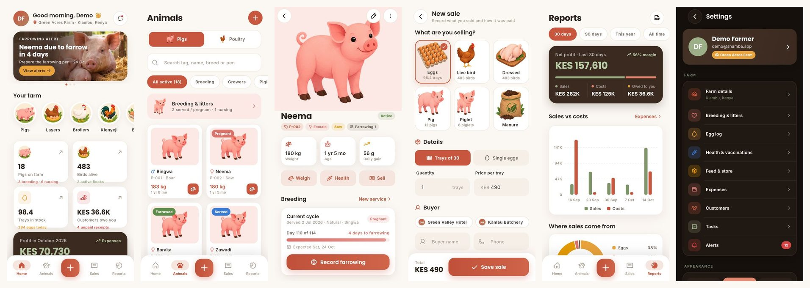

# Shamba. — Pig & Poultry Farm Manager

**Your farm, in your pocket.** A Flutter app for smallholder farmers to manage pigs, layers, broilers and kienyeji chicken, record egg collection, and track every sale of eggs, chicken and pigs — including who still owes money.



Works fully **offline**: every record is stored on the phone, with backup and restore to a file.

---

## Features

| Area | What you can do |
|---|---|
| **Pigs** | Tag, name, photo, sex, stage (piglet → sow/boar), breed, pen, parents. Weight history with growth chart and daily gain. Record death, restore, delete. |
| **Breeding** | Record service (natural or A.I.). Auto heat-check (day 21) and farrowing date (day 114). Confirm pregnancy, record farrowing (optionally adds every live piglet to the herd), record weaning (piglets move to weaner stage). Litter stats. |
| **Poultry** | Flocks of layers, broilers or kienyeji with breed, house, age and cost. Birds alive is always calculated from deaths and sales. Lay rate, mortality rate. |
| **Eggs** | Daily collection per flock (good vs broken), egg stock in trays, 7/30/90-day charts. Duplicate-day and impossible counts are blocked. |
| **Sales** | Sell eggs (trays or pieces), live or dressed chicken, pigs, piglets and manure. Stock is checked before saving. Cash, M-Pesa (with code), bank or credit. Part-payments, balances, receipts (share / print as PDF), call / SMS / WhatsApp reminders to buyers. |
| **Customers** | Created automatically from sales. Total bought, balance owed, history. |
| **Health** | Vaccinations, treatments, deworming, vitamins, check-ups for pigs or flocks. Next-dose reminders; costs go to expenses automatically. |
| **Feed & store** | Feed, medicine, vaccines and supplies. Buy (adds an expense) and use (per flock / pig). Low-stock and "runs out in X days" alerts, expiry alerts. |
| **Expenses** | Categories with donut chart; auto-created from purchases, vet costs and animal purchases. |
| **Tasks** | Daily repeating chores and one-off tasks with priority; progress ring for today. |
| **Alerts** | Farrowing due, heat checks, weaning, vaccines due, low stock, expiring medicine, unpaid debts, overdue tasks. Swipe to dismiss. |
| **Reports** | Profit / loss, sales vs costs chart, sales by product, egg production, livestock summary, top customers. Export a full PDF report. |
| **Account** | Sign up, log in (with lock-out after 5 wrong attempts), offline password reset (email + phone), profile, change password, delete account. Light / dark / auto theme. |

A **demo farm** ("Explore the demo farm" on the login screen) fills the app with three months of realistic records so every screen can be explored.

## Screens

Splash · Onboarding (3) · Login · Sign up · Forgot password · Farm setup (2 steps) · Home dashboard · Alerts · Animals (Pigs / Poultry) · Pig form · Pig detail · Breeding & litters · Flock form · Flock detail · Egg log · New sale · Sale success · Sale receipt · Sales · Customers · Customer detail · Health · Health record form · Feed & store · Store item detail · Expenses · Tasks · Reports · Settings · Profile · Not found · Startup error — plus bottom-sheet forms for weights, service, farrowing, weaning, deaths, eggs, payments, stock, expenses, tasks and customers.

## Design

- Brand palette (earthy): terracotta `#C8553D` for actions, soil brown `#3B2A20` for summary cards, warm cream `#FBF7F2` background, sage `#9CAF88` for growth/sales and amber `#E9A23B` for eggs, with a warm-brown dark theme.
- Typography: **Poppins** (headings) and **Inter** (body), bundled so the app looks right offline.
- Icons: **Phosphor** (regular, bold and fill weights), bundled as fonts in `lib/core/theme/phosphor.dart`.
- Custom illustrations in `assets/images/` (characters, products, categories, empty states, banners). The farmer, pig, hens and egg are separate layers so they can be animated in code.
- Motion: animated splash (logo pop, hen walks in pecking, pig bounces, egg drops), staggered list entrances, count-up numbers, auto-scrolling banners, press-scale on every tappable card, confetti on a successful sale.

## Error handling

- `main.dart` catches framework, platform and zone errors; a broken widget shows a calm card instead of the red error screen.
- If storage can't open at launch, a **Startup error** screen offers *Try again* and, as a last resort, *Reset app storage*.
- Every record is stored as its own JSON value; corrupt records are skipped (and counted) instead of crashing the app.
- All writes go through `guard()`, which turns any failure into a friendly message (`friendlyError`).
- Farm rules are enforced in `FarmStore` with clear messages: not enough eggs in stock, more birds than are alive, pig already sold, payment above balance, duplicate tags, farrowing before service, stock going negative, and more.
- Camera, gallery, phone, SMS, WhatsApp, sharing, printing and file picking all fail gracefully with a helpful message.

## Project structure

```
lib/
  main.dart, app.dart          bootstrap, global error handling, theme
  core/                        theme, colors, icons, formatters, validators, exceptions
  data/models/                 Pig, Flock, Sale, Customer, HealthRecord, … (+ enums)
  data/storage/local_db.dart   Hive wrapper (one JSON record per key)
  state/                       AuthController, FarmStore (all business rules), DemoData
  widgets/                     buttons, fields, cards, charts, toasts, dialogs
  features/                    one folder per area (auth, home, animals, pigs, poultry,
                               sales, customers, health, inventory, finance, tasks,
                               alerts, reports, settings, splash, onboarding, system)
test/                          business-rule, auth, backup and validator tests
```

## Run it

Requires Flutter 3.47 or newer (Dart 3.13+). Built and tested with Flutter 3.47.7.

```bash
flutter pub get
flutter run                 # on a connected phone or emulator
flutter test                # 20 tests
flutter build apk --release # Android APK in build/app/outputs/flutter-apk/
flutter build web           # browser preview
```

Regenerate launcher icons / native splash after changing the logo:

```bash
dart run flutter_launcher_icons
dart run flutter_native_splash:create
```

## Notes

- Accounts and data live on the device (no server needed). Use **Settings → Back up data** regularly and keep the file on Google Drive, WhatsApp or email.
- Default currency is KES; Uganda, Tanzania, Rwanda, Nigeria, Ghana, South Africa and USD are also supported. Eggs per tray (30 / 20 / 12) is configurable.
- Icons: [Phosphor Icons](https://phosphoricons.com) (MIT). Fonts: Poppins and Inter (SIL Open Font License).
